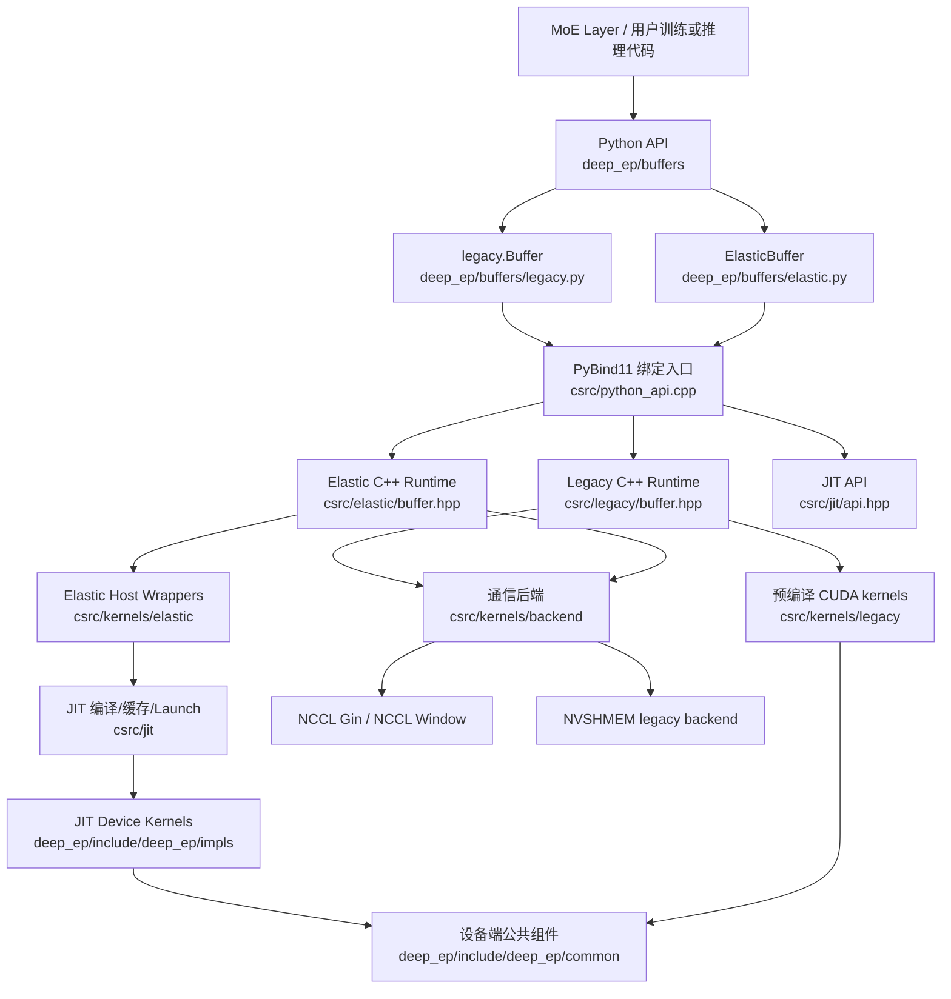
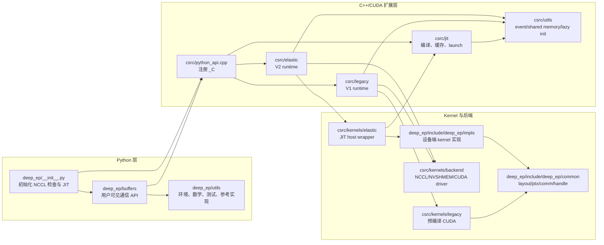
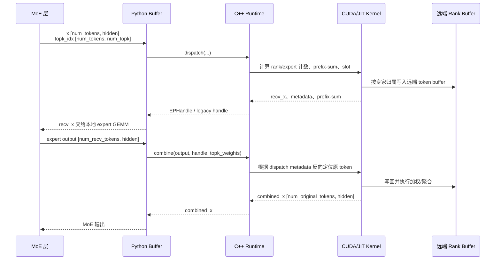
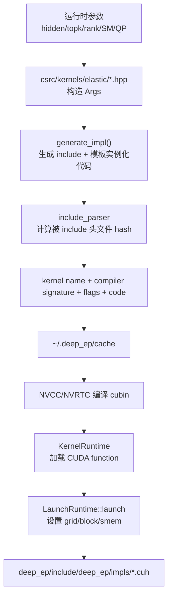
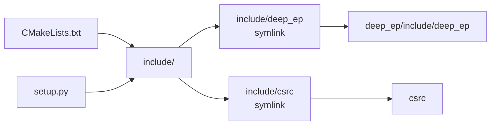
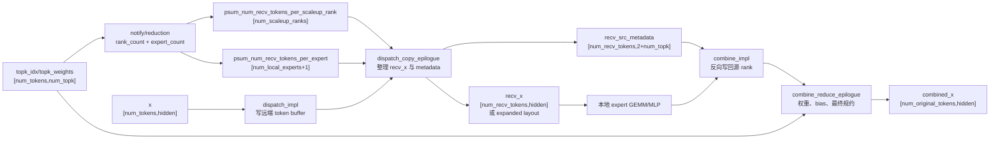
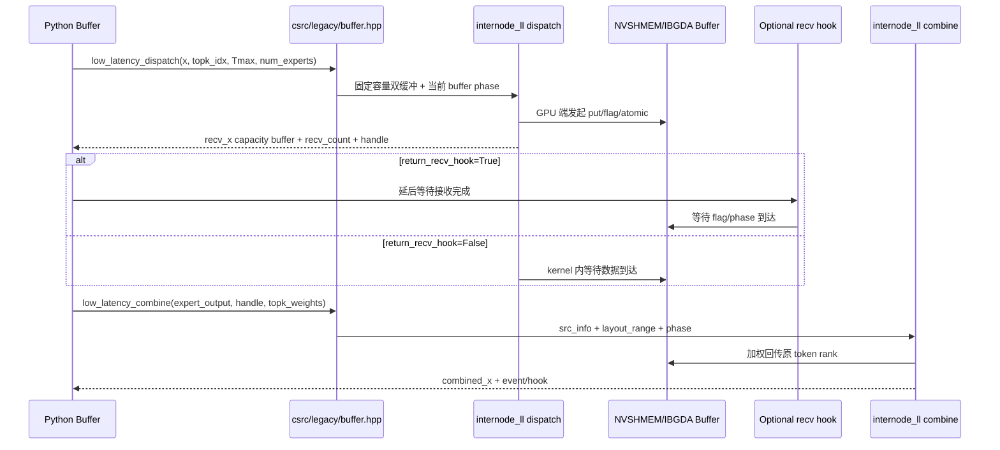
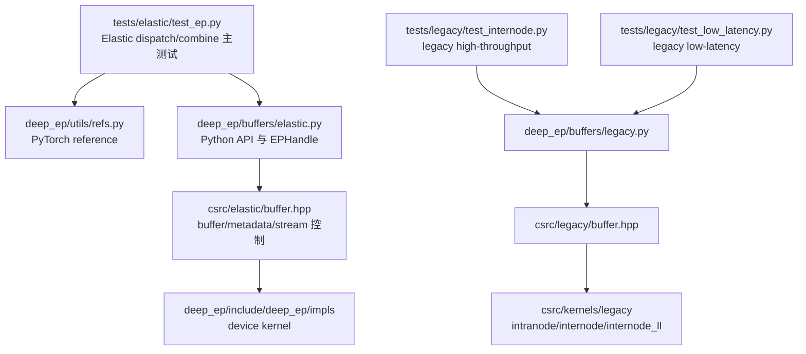

# DeepEP 架构设计、模块依赖与学习路线

本文用于配合源码注释学习 DeepEP。DeepEP 的核心场景是 MoE expert parallel：模型先根据 gating 结果得到 `topk_idx/topk_weights`，`dispatch` 将 token 路由到专家所在 rank，专家计算后 `combine` 再把专家输出按原 token 聚合回去。

## 1. 总体架构

两条主线：

- **Elastic/V2 路径**：推荐优先学习。Python [ElasticBuffer](../deep_ep/buffers/elastic.py) 调用 C++ [ElasticBuffer runtime](../csrc/elastic/buffer.hpp)，再通过 [csrc/kernels/elastic](../csrc/kernels/elastic) 生成模板实例代码，由 [csrc/jit](../csrc/jit) 编译并启动 [deep_ep/include/deep_ep/impls](../deep_ep/include/deep_ep/impls) 下的 device kernel。
- **Legacy/V1 路径**：保留 NVSHMEM 相关实现。Python [Buffer](../deep_ep/buffers/legacy.py) 调用 [csrc/legacy/buffer.hpp](../csrc/legacy/buffer.hpp)，再启动 [csrc/kernels/legacy](../csrc/kernels/legacy) 下的预编译 CUDA kernel。

## 2. 模块依赖关系

## 3. Dispatch / Combine 数据流

关键数据结构：

| 名称 | 维度 | 位置 | 含义 |
| --- | --- | --- | --- |
| `x` | `[num_tokens, hidden]` | Python `dispatch` 输入 | 原始 token。BF16 常规路径；FP8 路径中会拆成 `(x, scale)`。 |
| `topk_idx` | `[num_tokens, num_topk]` | Python/CUDA 共享 | 每个 token 选择的 expert id，`-1` 表示该 top-k 槽无效。 |
| `topk_weights` | `[num_tokens, num_topk]` | combine 使用 | 多专家输出聚合时的权重。 |
| `recv_x` | `[num_recv_tokens, hidden]` 或 `[num_local_experts, capacity, hidden]` | dispatch 输出 | 本 rank 收到、即将给本地专家计算的 token。 |
| `recv_src_metadata/src_metadata` | 通常为 `[num_recv_tokens, metadata_stride]` | C++ handle / CUDA kernel | 记录原始 token、rank/top-k 槽位，combine 依赖它把结果写回原 rank。 |
| `psum_num_recv_tokens_per_scaleup_rank` | `[num_scaleup_ranks]` | Elastic handle | rank 级接收 token 前缀和，最后一个元素常用于得到接收总数。 |
| `psum_num_recv_tokens_per_expert` | `[num_local_experts]` | Elastic handle | 本地专家接收 token 前缀和，可能包含 `expert_alignment` padding。 |

## 4. JIT 编译路径

这个设计的关键点是：rank 数、hidden 大小、top-k 数、SM/QP 数等运行时信息会变成模板参数。这样 CUDA 编译器可以消除很多动态分支，但首次遇到某个配置时需要 JIT 编译一次。

## 5. 建议学习路线

1. 先读 [README.md](../README.md) 的接口示例，建立 `dispatch -> expert compute -> combine` 的业务模型。
2. 读 [deep_ep/__init__.py](../deep_ep/__init__.py)，理解导入包时为何要检查 NCCL、初始化 JIT。
3. 读 [deep_ep/buffers/elastic.py](../deep_ep/buffers/elastic.py)，重点看 `EPHandle`、`ElasticBuffer.dispatch`、`ElasticBuffer.combine` 的维度和 handle 复用逻辑。
4. 读 [csrc/python_api.cpp](../csrc/python_api.cpp)，确认 Python 调用如何映射到 C++。
5. 读 [csrc/elastic/buffer.hpp](../csrc/elastic/buffer.hpp)，重点看 buffer size 估算、workspace、dispatch/combine 返回 tuple。
6. 读 [csrc/kernels/elastic/dispatch.hpp](../csrc/kernels/elastic/dispatch.hpp) 和 [deep_ep/include/deep_ep/impls/dispatch.cuh](../deep_ep/include/deep_ep/impls/dispatch.cuh)，跟踪 `topk_idx` 如何变成 rank/expert 计数和远端写入。
7. 读 [deep_ep/include/deep_ep/impls/combine.cuh](../deep_ep/include/deep_ep/impls/combine.cuh)，把 dispatch metadata 与 combine 回写对应起来。
8. 再读 legacy 路径：[deep_ep/buffers/legacy.py](../deep_ep/buffers/legacy.py)、[csrc/legacy/buffer.hpp](../csrc/legacy/buffer.hpp)、[csrc/kernels/legacy](../csrc/kernels/legacy)，对比 V1/V2 的实现差异。
9. 最后结合 [tests/elastic](../tests/elastic) 和 [tests/legacy](../tests/legacy) 跑小规模用例，验证各张量维度和 handle 内容。

## 6. include 目录说明

根目录新增 `include/` 用于 IDE 和编译器代码索引：

这样 `<deep_ep/...>` 和项目内部 `csrc/...` 头文件都能从同一个根目录解析，同时真实声明仍保留在原文件中，不会出现复制后的同步问题。

## 7. 核心代码跳转表

| 学习主题 | 建议入口 | 继续跳转 | 重点问题 |
| --- | --- | --- | --- |
| 包导入与运行时初始化 | [deep_ep/__init__.py](../deep_ep/__init__.py) | [deep_ep/utils/find_pkgs.py](../deep_ep/utils/find_pkgs.py)、[csrc/jit/api.hpp](../csrc/jit/api.hpp) | 为什么导入时要先检查 NCCL，再初始化 JIT 路径。 |
| Python Elastic API | [deep_ep/buffers/elastic.py](../deep_ep/buffers/elastic.py) | [csrc/python_api.cpp](../csrc/python_api.cpp)、[csrc/elastic/buffer.hpp](../csrc/elastic/buffer.hpp) | `EPHandle` 中哪些 tensor 会被 combine 复用。 |
| Python Legacy API | [deep_ep/buffers/legacy.py](../deep_ep/buffers/legacy.py) | [csrc/legacy/buffer.hpp](../csrc/legacy/buffer.hpp)、[csrc/kernels/legacy/api.cuh](../csrc/kernels/legacy/api.cuh) | legacy 如何通过 CUDA IPC/NVSHMEM 暴露 peer buffer。 |
| PyBind11 绑定 | [csrc/python_api.cpp](../csrc/python_api.cpp) | [csrc/kernels/backend/api.cuh](../csrc/kernels/backend/api.cuh) | Python 的 `Tensor`、`Config`、communicator 句柄如何映射到 C++。 |
| Elastic host runtime | [csrc/elastic/buffer.hpp](../csrc/elastic/buffer.hpp) | [csrc/kernels/elastic/dispatch.hpp](../csrc/kernels/elastic/dispatch.hpp)、[csrc/kernels/elastic/combine.hpp](../csrc/kernels/elastic/combine.hpp) | workspace 如何切分，JIT kernel 参数如何组装。 |
| JIT 编译缓存 | [csrc/jit/compiler.hpp](../csrc/jit/compiler.hpp) | [csrc/jit/cache.hpp](../csrc/jit/cache.hpp)、[csrc/jit/include_parser.hpp](../csrc/jit/include_parser.hpp)、[csrc/utils/hash.hpp](../csrc/utils/hash.hpp) | kernel 源码、include 文件和编译选项如何共同构成 cache key。 |
| Elastic device kernel | [deep_ep/include/deep_ep/impls/dispatch.cuh](../deep_ep/include/deep_ep/impls/dispatch.cuh) | [deep_ep/include/deep_ep/impls/combine.cuh](../deep_ep/include/deep_ep/impls/combine.cuh)、[deep_ep/include/deep_ep/common](../deep_ep/include/deep_ep/common) | token 的 rank/expert/slot metadata 如何写入并在 combine 阶段反向使用。 |
| 通信后端 | [csrc/kernels/backend/api.cuh](../csrc/kernels/backend/api.cuh) | [csrc/kernels/backend/nccl.cu](../csrc/kernels/backend/nccl.cu)、[csrc/kernels/backend/nvshmem.cu](../csrc/kernels/backend/nvshmem.cu) | NCCL window、NVSHMEM 对称内存、CUDA driver flag 同步分别解决什么问题。 |
| 测试与参考实现 | [tests/elastic/test_ep.py](../tests/elastic/test_ep.py) | [deep_ep/utils/refs.py](../deep_ep/utils/refs.py)、[tests/legacy](../tests/legacy) | 如何用小规模张量验证 dispatch/combine 的维度和数值。 |

## 8. Elastic 与 Legacy 对照

```mermaid
flowchart TB
    subgraph Elastic["Elastic / EPv2"]
        EPy["deep_ep.buffers.ElasticBuffer"]
        EHandle["EPHandle<br/>保存 rank/expert psum 与 src metadata"]
        EHost["csrc/elastic/buffer.hpp<br/>host runtime"]
        EJit["csrc/jit<br/>按运行时形状编译"]
        EDev["deep_ep/include/deep_ep/impls<br/>JIT device kernel"]
        ENccl["NCCL window + Gin"]
        EPy --> EHandle --> EHost --> EJit --> EDev --> ENccl
    end

    subgraph Legacy["Legacy / EPv1"]
        LPy["deep_ep.buffers.Buffer"]
        LHandle["EventHandle / layout metadata"]
        LHost["csrc/legacy/buffer.hpp<br/>host runtime"]
        LPre["csrc/kernels/legacy<br/>预编译 CUDA"]
        LBack["CUDA IPC / NVSHMEM"]
        LPy --> LHandle --> LHost --> LPre --> LBack
    end
```

Elastic 的核心优势是把 `hidden`、`num_topk`、rank 拓扑和部分通信配置固化为模板参数，再用 JIT 生成专门 kernel。Legacy 的优势是路径更固定，适合对照学习通信 primitive、low-latency buffer 和历史 API 兼容。

## 8.1 Elastic 关键张量流

这张图建议配合以下文件阅读：

- [csrc/kernels/elastic/dispatch.hpp](../csrc/kernels/elastic/dispatch.hpp)：host 侧如何把 Python 参数转成 JIT `Args`。
- [deep_ep/include/deep_ep/impls/dispatch.cuh](../deep_ep/include/deep_ep/impls/dispatch.cuh)：单层 dispatch 主通信与 slot 分配。
- [deep_ep/include/deep_ep/impls/dispatch_copy_epilogue.cuh](../deep_ep/include/deep_ep/impls/dispatch_copy_epilogue.cuh)：把通信 buffer 整理成 Python 可消费的 `recv_x` 和 metadata。
- [deep_ep/include/deep_ep/impls/combine.cuh](../deep_ep/include/deep_ep/impls/combine.cuh)：根据 metadata 把 expert 输出送回源 rank。
- [deep_ep/include/deep_ep/impls/combine_reduce_epilogue.cuh](../deep_ep/include/deep_ep/impls/combine_reduce_epilogue.cuh)：最终权重规约与 bias 叠加。

## 8.2 Legacy Low-Latency 控制流

## 9. 用测试反推实现

建议把测试当作“可执行规格”阅读：

1. [tests/elastic/test_ep.py](../tests/elastic/test_ep.py) 覆盖 `do_handle_copy`、FP8、bias、异步事件、cached handle、expanded layout 等核心组合；读它可以确认每个 API 返回值的真实形状。
2. [deep_ep/utils/refs.py](../deep_ep/utils/refs.py) 是最适合先读的正确性参考：它用 PyTorch `all_to_all_single` 和有序累加解释 dispatch/combine 的数学语义。
3. [tests/legacy/test_internode.py](../tests/legacy/test_internode.py) 对照 legacy 普通跨节点路径，重点看 RDMA rank、NVL rank、`SourceMeta` 和 cached handle。
4. [tests/legacy/test_low_latency.py](../tests/legacy/test_low_latency.py) 对照低延迟固定容量路径，重点看 `packed_recv_x`、`layout_range`、`phase`、hook 和 shrink/mask buffer。
5. 如果某个字段难理解，先在测试中搜索字段名，再跳到 Python Buffer，再跳到 C++ runtime，最后进入 CUDA kernel。这个顺序比直接从 kernel 入口读更不容易迷路。

低延迟路径的学习重点：

- 固定容量：`recv_x` 不是精确 `[num_recv_tokens, hidden]`，而是 `[num_local_experts, num_ranks*Tmax, hidden]`，有效范围由 `recv_count/layout_range` 指示。
- 双缓冲：连续两轮 low-latency 调用复用 RDMA buffer 的不同 phase，因此用户不能长期持有超过两轮结果。
- hook：`return_recv_hook=True` 时把“发起通信”和“等待接收完成”拆开，便于把等待放到 expert 计算之后。
- mask/shrink：`low_latency_update_mask_buffer`、`query_mask_buffer`、`clean_mask_buffer` 只影响 low-latency 路径，用于动态屏蔽 rank。

## 9. 关键实现细节

### 9.1 Dispatch 为什么要保存 metadata

`dispatch` 不只是把 token 搬到目标 expert 所在 rank，还必须为 `combine` 留下反向索引。一个 token 可能有多个 top-k expert，例如 `topk_idx[token=3] = [7, 12]`，那么 dispatch 会产生两个专家输入槽；combine 需要知道这两个槽都来自原始 token 3，并且分别对应 top-k 槽 0 和 1，才能用 `topk_weights[3, 0]`、`topk_weights[3, 1]` 加权写回。相关代码可从 [deep_ep/buffers/elastic.py](../deep_ep/buffers/elastic.py) 的 `EPHandle` 跳到 [deep_ep/include/deep_ep/impls/combine.cuh](../deep_ep/include/deep_ep/impls/combine.cuh)。

### 9.2 前缀和为什么到处出现

token 路由本质上是“按 rank、按 expert 分桶”。每个桶先统计数量，再做 prefix-sum，才能把并行线程得到的局部 token 写入稳定的连续区间。例如 `psum_num_recv_tokens_per_expert[e]` 表示第 `e` 个本地 expert 之前累计接收了多少 token，因此 expert `e` 的 token 起点就是这个前缀和。Elastic host runtime 会把这些 psum tensor 放入 handle，方便 Python expert GEMM 按专家切分输入。

### 9.3 JIT cache 为什么要解析 include

Elastic kernel 的 host wrapper 会生成一小段 CUDA 源码，但真正实现大量在 `deep_ep/include/deep_ep/impls/*.cuh`。如果只 hash 生成源码，不 hash 被 include 的头文件，修改 device kernel 后可能仍复用旧 cubin。于是 [csrc/jit/include_parser.hpp](../csrc/jit/include_parser.hpp) 会递归解析 include，配合 [csrc/utils/hash.hpp](../csrc/utils/hash.hpp) 把头文件内容纳入 cache key。

### 9.4 NCCL 检查为什么在导入时执行

DeepEP 既依赖 PyTorch 已加载的 NCCL，也会为自身 JIT/扩展查找 NCCL。若两者不是同一个二进制，host communicator、device communicator 或 Gin 相关结构可能 ABI 不一致。导入 [deep_ep/__init__.py](../deep_ep/__init__.py) 时执行 `check_nccl_so()`，是为了尽早发现“PyTorch 用一份 NCCL、DeepEP 编译链接另一份 NCCL”的环境错误。

## 10. 阅读建议

第一次读代码时建议只跟一条最短链路：

读完这条链路后，再补三块背景：

1. 通信后端：[csrc/kernels/backend/api.cuh](../csrc/kernels/backend/api.cuh) 与 [csrc/kernels/backend/nccl.cu](../csrc/kernels/backend/nccl.cu)。
2. JIT 生命周期：[csrc/jit/compiler.hpp](../csrc/jit/compiler.hpp)、[csrc/jit/kernel_runtime.hpp](../csrc/jit/kernel_runtime.hpp)、[csrc/jit/launch_runtime.hpp](../csrc/jit/launch_runtime.hpp)。
3. 参考实现和测试：[deep_ep/utils/refs.py](../deep_ep/utils/refs.py)、[tests/elastic/test_ep.py](../tests/elastic/test_ep.py)、[tests/legacy/test_low_latency.py](../tests/legacy/test_low_latency.py)。
